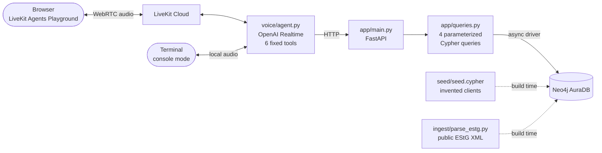
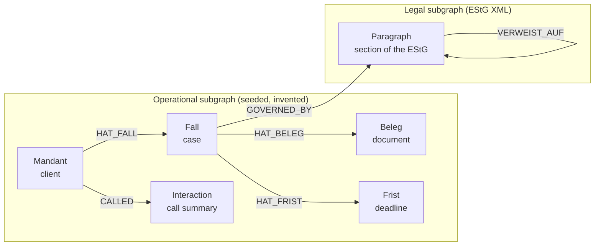

# SteuerGraph

A German voice agent that answers status calls for a tax firm from a Neo4j knowledge graph. I built it in one day at the Neo4j Mini Hack, part of Global AI Construct in Berlin (25 August 2026), a hands-on hackathon around Neo4j, GraphRAG, agentic AI and MCP. It took 3rd place out of 18 projects in the public vote ([results post](https://www.linkedin.com/feed/update/urn:li:activity:7498344697799798785/)).

All client data is invented. The legal part of the graph comes from the public XML of the Einkommensteuergesetz (EStG, the German Income Tax Act).

## The problem

Staff at tax firms keep getting interrupted by clients calling about their case: is my return done, what's still missing, when is the deadline, why does this paragraph apply to me. Each answer needs several hops: from the caller to their cases, to the documents that are in or missing, to the deadlines, and to the sections of the EStG that govern each case and what those sections cite.

Plain vector retrieval over documents flattens that into text chunks that look alike, and the path between the facts gets lost. In a graph the path is the data, so each question the agent supports is one fixed query.

## Demo

The demo is two calls (full runbook in [docs/DEMO.md](docs/DEMO.md)):

1. A status call. I give a client's name from the seed data, ask how my tax return is going, what's still missing and why § 35a matters for me, then say goodbye. The agent answers from the graph and, before hanging up, writes a one-line summary of the call back to the graph.
2. A memory call, in a new session that knows nothing about the first one. I ask what we talked about last time, and the agent reads back the summary it wrote a minute earlier. The memory lives in the graph, not in the session.

## How it works



The voice agent runs on LiveKit Agents with OpenAI Realtime (`gpt-realtime-2`, speech to speech). Its tools don't talk to Neo4j directly: they call the FastAPI app over HTTP, and all Cypher lives in `app/queries.py`. The API keeps one async Neo4j driver for the whole process; the seed and ingest scripts use the sync driver.

## Graph model

Two subgraphs, joined at `Fall`:



| Label | Properties | Where it comes from |
|---|---|---|
| `Mandant` | `id`, `name`, `typ` | seed: 12 clients |
| `Fall` | `id`, `art`, `status` | seed: 15 cases (income tax returns, EÜR, VAT filings, one objection) |
| `Beleg` | `id`, `art`, `status` (`vorhanden` or `fehlt`) | seed: 20 documents, 8 of them missing |
| `Frist` | `id`, `art`, `datum` | seed: 5 deadlines |
| `Interaction` | `id`, `datum`, `zusammenfassung` | seed: 5 past calls; the agent adds one per call |
| `Paragraph` | `id` (`9`, `35a`, ...), `gesetz`, `titel`, `kurzname` | one node per § in the EStG XML |

- `GOVERNED_BY` is the join: the seed links cases to the sections that apply to them (14 links). It `MERGE`s the `Paragraph` nodes, so seeding and ingesting work in either order.
- `VERWEIST_AUF` is the citation network. `ingest/parse_estg.py` reads each `<norm>` whose `<enbez>` is a § number, takes its `<titel>`, and finds references in the text with the regex `§§?\s*(\d+[a-z]?)`. Self-references are dropped, and an edge is only kept if its target is a § that exists in the EStG, so references into other laws don't create phantom nodes.
- `kurzname` is a short spoken label for the 10 linked sections. The official title is missing for some of them (§§ 10, 18, 19, 21) and too long to say for others (§ 35a). The parser only writes `titel` and `gesetz`, so these labels survive a re-ingest.
- The seed is idempotent: everything is `MERGE`d on stable ids, with a uniqueness constraint on each label's `id`.

## How the voice agent stays reliable

There is no text2cypher at runtime: the model never writes a query. It picks one of six fixed tools, and what the caller says only ever reaches Cypher as a parameter (`$mandant`, `$paragraph`). Every query that runs during a call is reviewed code in `app/queries.py`. There is no vector search either.

| Tool | Calls | Used for |
|---|---|---|
| `status_abfragen(mandant)` | `GET /status/{mandant}` | full status of a client's cases |
| `fehlende_belege(mandant)` | `GET /missing/{mandant}` | "What's still missing?" |
| `paragraph_erklaeren(paragraph)` | `GET /why/{paragraph}` | why a section of the EStG applies |
| `letzte_anrufe_abfragen(mandant)` | `GET /status/{mandant}`, returns only the last calls | "What did we discuss last time?" |
| `anruf_protokollieren(mandant, zusammenfassung)` | `POST /interaction` | writes the one-line call summary before goodbye |
| `auflegen()` | none | waits until the goodbye has finished playing, then ends the call |

The rest:

- Failures come back as instructions, not exceptions. When the API returns 404, fails or can't be reached, the tool returns a message that starts with `[STEUERUNG – NICHT VORLESEN]` ("control, don't read aloud"). The prompt tells the model to follow it without reading it out: apologize briefly and offer a callback from a colleague.
- The prompt keeps the agent short and grounded: German only, formal "Sie", at most two short sentences and one question per reply, numbers, dates and section numbers spoken as words, never read JSON or tool names aloud, ask for the caller's name first and use it for every lookup, and answer factual questions only from the tools.
- Memory sits in the same graph as the case data. Before saying goodbye, the agent stores the call as an `Interaction` node, so one query can join a client's past calls with their cases. The model never decides what gets written where: it can only post a one-line summary, which a fixed query stores. Past calls are also part of `/status`, but they got a dedicated tool (`letzte_anrufe_abfragen`) so the model finds them when the caller asks about an earlier conversation.

## Setup and run

You need Python 3.12+, [uv](https://docs.astral.sh/uv/), a Neo4j AuraDB instance (the free tier is enough), and for the voice layer a LiveKit Cloud project and an OpenAI API key.

```bash
cp .env.example .env   # Aura credentials from the credentials download; LiveKit + OpenAI keys for the voice layer
uv sync
```

Build the graph:

```bash
uv run python seed/run_seed.py        # operational subgraph, constraints, spoken labels, seeded calls
# download https://www.gesetze-im-internet.de/estg/xml.zip and unzip the BJNR*.xml to data/estg.xml
uv run python ingest/parse_estg.py    # legal subgraph (or pass the XML path as an argument)
```

Run the API:

```bash
uv run uvicorn app.main:app --reload   # http://127.0.0.1:8000, OpenAPI docs at /docs
```

Run the voice agent (the API has to be running):

```bash
uv run python voice/agent.py console   # talk to it in the terminal, no LiveKit Cloud needed
uv run python voice/agent.py dev       # register with your LiveKit Cloud project
```

With `dev`, open the [LiveKit Agents Playground](https://agents-playground.livekit.io), select your project, connect and speak German. The worker has no agent name, so it joins every new room in the project: use a project just for this. Set `STEUER_GRAPH_API` if the API isn't on `http://127.0.0.1:8000`.

On Windows, `.\demo.ps1` starts the API in a second PowerShell window and the agent in `dev` mode; `.\demo.ps1 console` uses the terminal loop instead.

Other scripts:

```bash
uv run pytest                          # 2 tests for POST /interaction, against the Aura instance in .env (they delete what they create)
uv run python scripts/reset_demo.py    # delete agent-written calls, keep the 5 seeded ones
```

## Endpoints

| Method | Path | Returns |
|---|---|---|
| `GET` | `/status/{mandant}` | the client, their cases with documents, deadlines and governing sections, and the last three calls. 404 if no client matches. |
| `GET` | `/missing/{mandant}` | missing documents per case, with that case's deadlines. An empty list if nothing is missing or no client matches. |
| `GET` | `/why/{paragraph}` | a section's title and spoken label, the sections it cites and is cited by, and the cases it governs. Takes `9` or `§ 9`. 404 if it's not in the graph. |
| `POST` | `/interaction` | stores `{"mandant", "zusammenfassung"}` as an `Interaction` node with a `CALLED` edge. 201 with both ids, 404 if no client matches. |

`{mandant}` can be a client id (`M002`) or part of the name, matched case-insensitively, so the agent can pass what it heard. For example, from the seed data:

```bash
curl http://127.0.0.1:8000/missing/M002
```

```json
{
  "mandant": "M002",
  "offene_punkte": [
    {
      "name": "Jonas Brückner",
      "fall": "F002",
      "fall_art": "ESt-Erklärung 2025",
      "fehlende_belege": ["Handwerkerrechnung", "Nachweis Fahrtkosten"],
      "fristen": [{"art": "Abgabefrist ESt 2025", "datum": "2026-09-30"}]
    }
  ]
}
```

## Queries to try in the Neo4j console

The most-cited sections of the EStG. On the version I loaded in August 2026, § 52 (Anwendungsvorschriften, the application rules) led with 134 incoming references:

```cypher
MATCH (p:Paragraph)<-[:VERWEIST_AUF]-(citing)
WITH p, count(citing) AS zitiert_von ORDER BY zitiert_von DESC LIMIT 10
RETURN p.id AS par, coalesce(p.kurzname, p.titel) AS thema, zitiert_von
```

Both subgraphs in one picture: call memory, client, case, law:

```cypher
MATCH p = (:Interaction)<-[:CALLED]-(:Mandant)-[:HAT_FALL]->(:Fall)-[:GOVERNED_BY]->(:Paragraph)
RETURN p LIMIT 50
```

The operational subgraph on its own:

```cypher
MATCH p = (:Mandant)-[:HAT_FALL]->(:Fall)-[:HAT_BELEG]->(:Beleg)
RETURN p LIMIT 50
```

The neighborhood of § 9 (Werbungskosten) in the citation network:

```cypher
MATCH p = (:Paragraph {id:'9'})-[:VERWEIST_AUF]-()
RETURN p
```

The calls one client has had, newest first, including the ones the agent wrote:

```cypher
MATCH (m:Mandant {id:'M002'})-[:CALLED]->(i:Interaction)
RETURN i.datum, i.zusammenfassung ORDER BY i.datum DESC
```

## What I'd build next

- Real caller identification. The agent asks for a name, and the API matches it by id or by a case-insensitive substring of the name. `/status` answers with the first match, and `POST /interaction` writes to every client that matches. On a phone line I'd identify the caller from their number plus a second factor, and require exactly one match before reading or writing anything.
- Phone calls instead of the browser, with Twilio SIP into LiveKit.
- A cascaded German pipeline (Deepgram speech-to-text, an LLM, ElevenLabs text-to-speech) instead of speech to speech, for more control over German recognition and pronunciation. The design doc keeps this as the upgrade path.
- Better citation parsing. The regex only takes the first number after "§§", can't tell an EStG reference from a reference into another law that uses the same number, and works on whole sections, not on individual Absätze.
- Tests that don't need a live Aura instance (Neo4j in Docker), covering the read endpoints too, and auth on the API. Right now it's open and meant to run next to the agent on one machine.

## Repository layout

```
app/        FastAPI app (main.py) and every Cypher query the API runs (queries.py)
voice/      LiveKit voice agent
seed/       seed.cypher and the script that runs it
ingest/     EStG XML parser for the legal subgraph
scripts/    reset_demo.py
tests/      tests for POST /interaction (live Aura)
docs/       demo runbook, voice-layer design spec and implementation plan
```

`.mcp.json` and `.vscode/mcp.json` connect the editor to the Aura MCP server and the GraphAcademy MCP server. I only used the Aura MCP server while building, to seed, inspect and check the graph from my AI pair-programmer; it's not in the runtime path.

`.agents/` and `.claude/` hold Neo4j agent skills vendored from the workshop starter (from `neo4j-contrib/neo4j-skills`, pinned in `skills-lock.json`); they're not part of the app.
